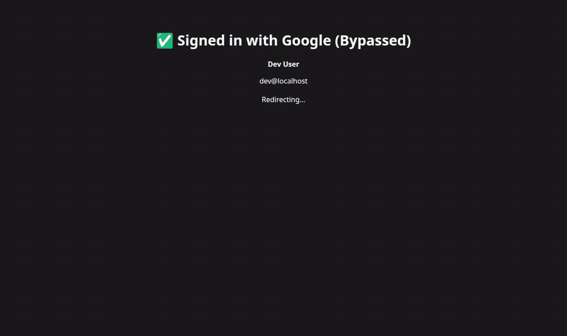

<div align="center">


# substrate-ui

**The chat that hands you back editable files — not just text.**

An AI-agent chatbot shell where the assistant's work opens in a side panel and
you can *edit it in place* — spreadsheets, docs, slides, and code — while the
agent keeps working on the same files, without either of you clobbering the
other.

<p>
  
  
  
  
</p>



</div>

---

## What it does

`substrate-ui` is the end-user chatbot for the **agent-framework** platform. It streams an agent's responses and renders them as a live, interactive workspace, then lets you take the wheel on anything the agent produces.

- 💬 **Streaming chat**: SSE with reasoning, tool calls, citations, read-aloud and regenerate. Per-model thinking effort.
- 📎 **Artifact panel**: code-interpreter output (HTML / PDF / images / CSV / Office / code) opens on the right. Office files edit in **BetterOffice** (client-side) and code in **Monaco**, saving through a version lineage so **human edits and the agent's rewrites reconcile**.
- 📄 **Documents**: upload a file and the assistant reads it by outline and section. A model-written summary and topic are shown in **Storage**; long documents are navigated, not pasted in.
- 🗂️ **Conversations**: pin, archive, search inside messages, export as Markdown or JSON, and share a read-only public link. Branching from any message.
- ⏰ **Scheduled**: recurring tasks with run history, cost, retry, and results in Notifications (and by email if you ask).
- ✅ **Approvals**: one inbox for everything the assistant is waiting on you for, across conversations.
- 🧠 **Personalization and Memory**: standing instructions, plus the facts the assistant remembers that you can add, reword and delete.
- 📊 **Usage**: messages, tokens and cost by day, and your daily limits always visible.
- ⚙️ **Settings**: theme, chat width, motion, timezone, keyboard shortcuts, connectors (Google Workspace, Spotify, MCP), models and voices, and **Download my data**.
- 🧩 **MCP App widgets**: tools can ship interactive UIs into the panel.

Everything uses one design system (`src/design`, see [`DESIGN.md`](src/design/DESIGN.md)): the same buttons, rows, pages, dropdowns and colour roles (orange acts, violet selects).

## Screenshots

<div align="center">
  
</div>

> The recording was made against a local stack with a throwaway account: new chat, a streamed answer, Scheduled, Approvals, Notifications, then General, Personalization, Usage and Storage settings.

## How it fits together

```
agent-substrate-platform (SaaS control plane)
  └─ user creates a chatbot Instance
        └─ substrate-ui  ← you are here (the chat shell)
              └─ talks to agent-substrate over HTTP + SSE
                    └─ agent runtime: tools, code interpreter, workspace files, versioning
```

The engine ([`agent-substrate`](../agent-substrate)) does the real work; this app
is the interface. Office editing runs entirely client-side via BetterOffice —
no separate document server.

## Quick start

You need Node 22+, pnpm, and a running [`agent-substrate`](../agent-substrate) backend (which needs PostgreSQL and Redis; see its [tech stack](../agent-substrate/README.md#-tech-stack-required-vs-opt-in)). Sign-in is Keycloak (the cell's realm, see [`deploy/keycloak`](../../deploy/keycloak)); this app needs a database only for its connector credentials.

```bash
pnpm install --frozen-lockfile
cp .env.local.example .env.local     # fill in the values below
pnpm prisma generate                 # runs on install too
pnpm db:push                         # provision the connector-credentials table
pnpm dev                             # http://localhost:3000
```

The backend must run separately — see
[`agent-substrate`](../agent-substrate) (`uv run start`, port 8000).

<details>
<summary><b>Scripts</b></summary>

```bash
pnpm dev            # dev server
pnpm build          # production build
pnpm start          # serve the production build
pnpm lint           # ESLint
pnpm typecheck      # tsc --noEmit
pnpm test           # vitest
pnpm db:studio      # Prisma Studio
```
</details>

## Environment

Copy `.env.local.example` → `.env.local`:

| Variable | Purpose |
|---|---|
| `BACKEND_API_URL` | Engine URL for server-side routes / the `/api/backend/*` proxy (default `http://localhost:8000`). |
| `NEXT_PUBLIC_API_URL` | Engine URL baked into the browser bundle. Leave empty on Kubernetes so the browser uses ingress-relative paths. |
| `OIDC_ISSUER` | The realm URL, e.g. `https://id.example.com/realms/substrate`. |
| `OIDC_CLIENT_ID` / `OIDC_CLIENT_SECRET` | The confidential `substrate-ui` client of the realm (default id `substrate-ui`). |
| `OIDC_ORGANIZATION` | Optional: the organization alias to pin sessions to (scope `organization:<alias>`). `/chat/auth/login?org=<alias>` signs in to another organization (project) and switches the tenant. |
| `SESSION_SECRET` | 32+ characters; derives the keys that encrypt the session cookie (`openssl rand -hex 32`). |
| `PUBLIC_URL` | Where users reach this app (origin only, default `http://127.0.0.1:3000`); redirect URIs and cookies agree on it. |
| `DATABASE_URL` | Prisma database for the connector credentials (`UserCredential`) only; accounts and sessions are Keycloak's. |
| `ENCRYPTION_KEY` | Encrypts stored Spotify/Workspace OAuth tokens (`openssl rand -hex 32`). Must be this exact name. |
| `NEXT_PUBLIC_BRAND_LOGO_URL` | Optional: your own logo (an image URL) in place of the default two-square mark. Replace `public/favicon.svg` for the browser tab. |

> **Identity note:** sign-in is the shared backend-for-frontend library
> ([`@substrate/oidc-bff`](../../identity/oidc-bff)): authorization code + PKCE, tokens in an encrypted httpOnly cookie, never in the browser.
> `/api/chat` and the `/api/backend/*` proxy call the Agent API (`/api/v1`) with the user's own access token, so agent-written files and
> browser reads share one identity. The tenant is the Keycloak organization in that token, and administrators are users with the
> `tenant_admin` realm role. There is no anonymous mode: no session means 401.

## Architecture notes

- All backend calls go through the `api` object in `src/lib/api/` — never
  `fetch` directly in components.
- Server → engine calls flow through the `/api/backend/*` catch-all proxy
  ([`route.ts`](src/app/api/backend/%5B...path%5D/route.ts)), which calls the
  Agent API (`/api/v1`) with the user's Keycloak access token.
- The chat page, SSE loop, and panel wiring live in
  [`src/app/[[...slug]]/page.tsx`](src/app/%5B%5B...slug%5D%5D/page.tsx); the artifact surfaces are
  [`FileArtifactViewer`](src/components/FileArtifactViewer.tsx),
  [`BetterOfficeEditor`](src/components/BetterOfficeEditor.tsx), and
  [`CodeEditorView`](src/components/CodeEditorView.tsx).

See [`.github/copilot-instructions.md`](.github/copilot-instructions.md) for
component conventions, the SSE event table, and Tailwind v4 rules.

## Docker

```bash
docker build -t substrate-ui .
```

Uses `node:22-alpine` (pnpm 11 requires Node ≥ 22.13) with pnpm pinned to the
lockfile's version.
